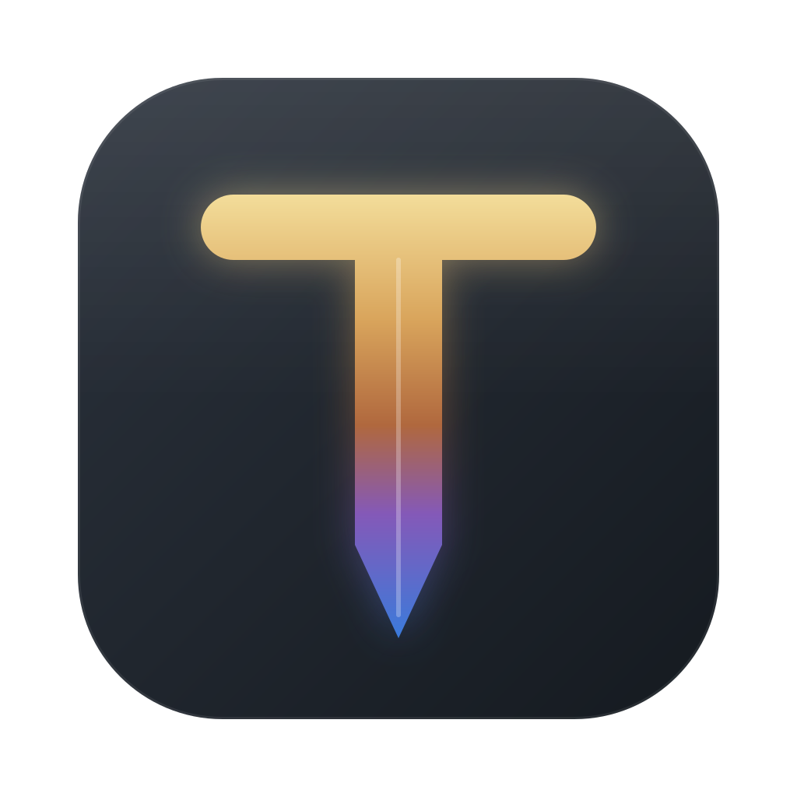

<p align="center"></p>

<h1 align="center">Temper</h1>
<p align="center">Run, fine-tune and ship open-weight AI models on your own computer.</p>

Temper is a desktop app for macOS, Windows and Linux. Download a model from Hugging Face, chat with it,
fine-tune it on your own data with [Unsloth](https://github.com/unslothai/unsloth) (or MLX on Apple
Silicon), export it to GGUF, and serve it to coding agents through an OpenAI-compatible API.

Tempering is the step after hardening steel. It tunes the metal for a specific job, which is what
fine-tuning does to a base model.

## What works today

- **Chat** with any GGUF model through llama.cpp, with streaming output and generation settings
- **Models**: search Hugging Face, pick a GGUF quant with a memory-fit check, download in the background, load
- **Train**: LoRA, QLoRA and full fine-tuning with Unsloth; LoRA with MLX on Apple Silicon; live loss chart and logs
- **Datasets**: preview Hugging Face or local CSV/JSON/JSONL datasets and detect their chat format
- **Export**: LoRA adapter, merged 16-bit/4-bit and GGUF (q4_k_m, q5_k_m, q8_0 and more)
- **Connect**: ready-made config for Codex, OpenCode, Continue, Aider, Python and curl
- **Hardware**: NVIDIA, AMD and Apple Silicon detection with a live memory meter

Everything else Unsloth offers is planned feature by feature in [PLAN.md](PLAN.md).

## Develop

You need Node 20+, Rust (stable) and [uv](https://docs.astral.sh/uv/).

```bash
npm install
npm run tauri dev        # UI + desktop shell; the shell starts the Python engine with uv
```

Optional pieces:

```bash
brew install llama.cpp                 # chat with GGUF models (or: winget install llama.cpp)
cd engine && uv sync --extra train     # training on NVIDIA / AMD / Intel GPUs
cd engine && uv sync --extra mlx       # training on Apple Silicon
```

To work on the UI in a browser, start the engine yourself with `cd engine && uv run temper-engine --token dev`,
then run `npm run dev` and open http://localhost:1420.

Tests: `cd engine && uv run --extra dev pytest`. Typecheck and build the UI: `npm run build`.

## Icons

`assets/icon.svg` is the master. `npm run icons` renders every platform size into `src-tauri/icons/`.

## Release

Push a tag such as `v0.1.0`. The Release workflow builds installers into a draft GitHub release:
DMG for Apple Silicon and Intel Macs, NSIS installers for Windows x64 and ARM64, and AppImage, deb and
rpm for Linux x64 and ARM64.

## License

Apache-2.0. See [THIRD_PARTY.md](THIRD_PARTY.md) for the projects Temper builds on.
